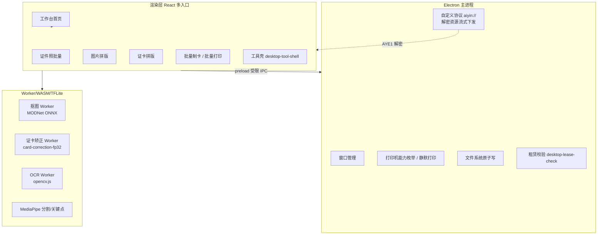
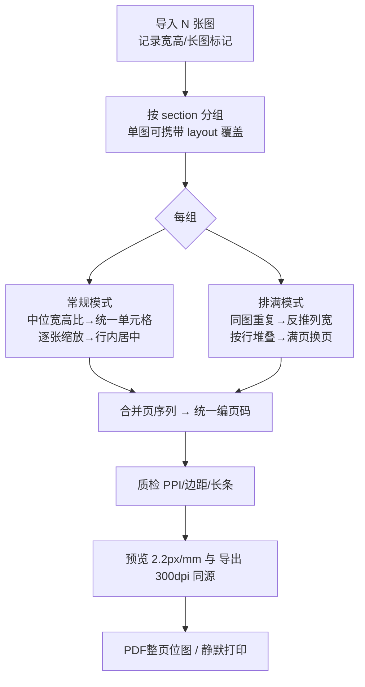
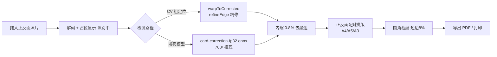
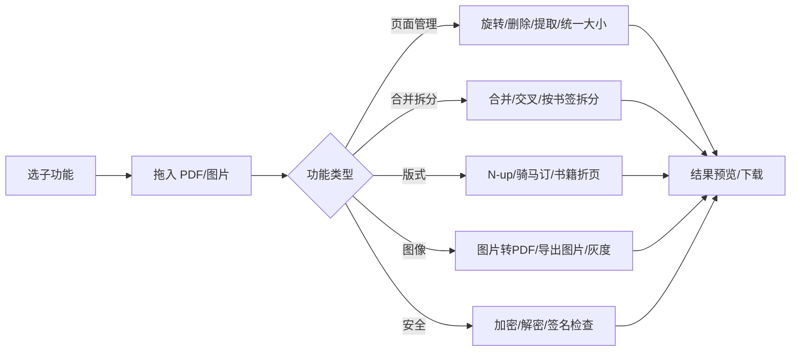
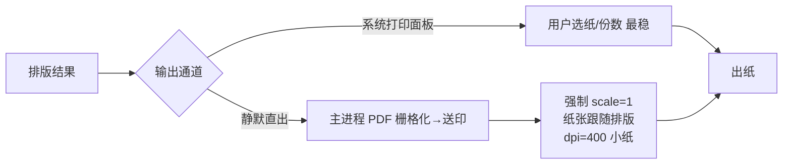
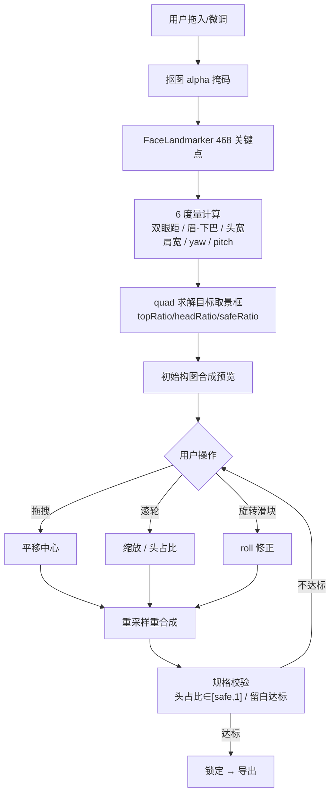
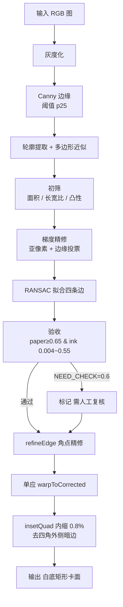
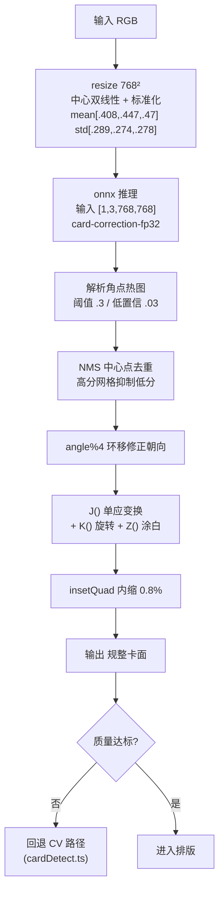
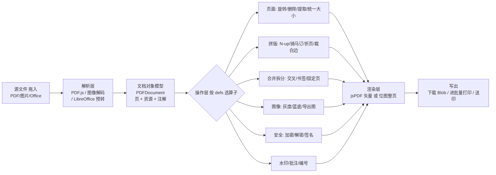
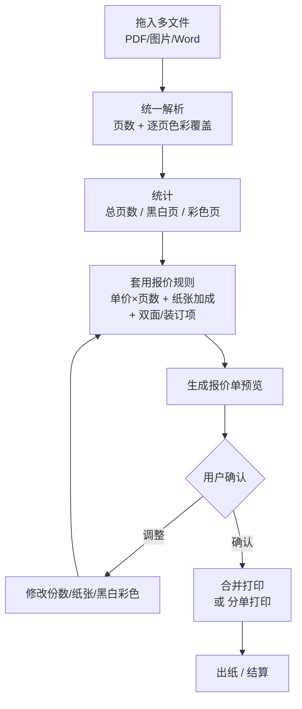

# 爱印工具箱 · 业务流程图

> 本册由《爱印产品规格与复刻总览》拆分而来，聚焦"各模块内部是怎么一步步跑的"。
> 配套分册：《产品概述与架构》《功能清单》《界面交互规范》《复刻路线图》（见总览索引）。
>
> 图例：框内 `<br/>` 表示换行；【原版图】= 总览已含；【新增细分】= 本次拆分时补充的更细流程图。

---

## 一、总览级流程图（原版图）

### 4.1 整体技术架构与加载【原版图】



### 4.2 证件照批量处理流程【原版图】

```mermaid
flowchart LR
    A[选择/拖入文件] --> B{过滤}
    B -->|非图片跳过| Z[忽略]
    B -->|HEIC 提示不支持| Z
    B -->|大于16MP 缩放路径| C[decode + 缩略图立即入列]
    C --> D[抠图队列 Worker池<br/>numThreads=min(4,cores-1)<br/>SAB失败降单线程]
    D --> E[alpha 回主线程]
    E --> F[换底合成<br/>在输出分辨率上做]
    F --> G[FaceLandmarker 关键点<br/>→6度量→按规格构图]
    G --> H[人工微调 取景编辑器]
    H --> I[导出 JPG/PDF 多规格]
```

> 关键：**合成在输出分辨率上做**。1 寸 295×413 相比 12MP 原图像素量仅 1/95，换底色从"秒级"降到"毫秒级"。

### 4.3 图片拼版流程【原版图】



### 4.4 证卡拼版 / 矫正流程【原版图】



### 4.5 PDF 工具箱处理流水线【原版图】



### 4.6 打印输出流程【原版图】



---

## 二、细分流程图（本次新增）

> 下列 6 张图把总览里较粗的环节拆开，便于复刻时逐函数对齐。

### 4.7 证件照 · 取景编辑器（构图微调）【新增细分】



> 不变量：`BOTTOM_FILL` 兜底填充 1.20/1.35；`TOL` 容差 0.02/0.015；两段式 `activeId`(预览) ≠ `checked`(导出)，避免 O(n²) 重算。

### 4.8 证卡 · CV 矫正路径细图【新增细分】



> 越界像素填**白色**（非黑）；残留黑边本质是"四角外侧的暗色内容"被 warp 带进画面，故用 0.8% 几何内缩（向质心收，不改长宽比）消除。

### 4.9 证卡 · 增强模型（fp32）推理细图【新增细分】



> 模型路径为主路径，失败/未检出时回退 CV；两路径互斥，内缩只做一次。`uprightCorners` 归一化后 `warpQuadToRect`。

### 4.10 PDF 引擎 · 数据流【新增细分】



> 几何以 mm 计算、出图乘 DPI，是"预览=导出=打印"同源的根本；48 项 defs 映射到上述算子。

### 4.11 批量打印 · 报价流程【新增细分】



> 区分黑白彩色靠逐页像素覆盖估算（非 CMYK 精确分离），用于报价与分桶；打印预设/相纸枚举为近似项（见路线图 P3）。

### 4.12 Office 转 PDF · 流程【新增细分】

```mermaid
flowchart TB
    A[选择 Office 文件<br/>Word/Excel/PPT] --> B{"本机有<br/>LibreOffice?"}
    B -->|否| C[提示引导安装<br/>链路不可用]
    B -->|是| D["--headless --convert-to pdf<br/>逐文件转换"]
    D --> E[产物 PDF 收集]
    E --> F{后续动作}
    F -->|合并| G[多文件合并为一份]
    F -->|PPT 讲义| H["N-up 讲义排版<br/>每页多张]
    F -->|单文件| I[直接输出]
    G --> J[输出 PDF]
    H --> J
    I --> J
    J --> K[进批量打印 / 下载]
```

> 依赖本机 LibreOffice 命令行；转换失败多为缺失字体或宏，自检内置 `self-test-*.pptx/.docx/.xlsx` 验证该链路。
