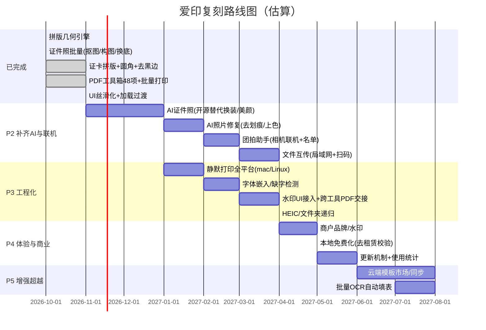

# 爱印工具箱 · 复刻进度与路线图

> 本册由《爱印产品规格与复刻总览》拆分而来，聚焦"已经复刻了什么、还差什么、未来怎么排期"。
> 配套分册：《产品概述与架构》《功能清单》《界面交互规范》《业务流程图》（见总览索引）。
>
> 复刻工程：aiyinbox-clone（超誉工作台 v0.0.12）。

---

## 6. 已复刻进度对照（clone = 超誉工作台）

### 6.1 已 1:1（有门禁）

- 拼版几何全部（纸张/方向/网格/自动行列/长图切分/排满/裁切线/尺寸标注/镜像/图注/页码/分组）
- 打印质检前三项（PPI/边距/长条）
- 预览与导出同源渲染、PDF 整页写满纸
- 证件照批量链路（抠图、按规格构图、换底、多尺寸导出、DPI 标记）
- 证卡拼版（CV+增强模型矫正、圆角、排版导出、去黑边）
- PDF 工具箱 48 项骨架 + 多数逻辑；批量打印；Office 转 PDF；PDF 预处理
- UI 丝滑化（过渡/按压/弹层/焦点/select/健康横幅）+ 加载过渡预览

### 6.2 近似（能用，未逐像素对齐）

- 打印对话框：只保留打印机/份数/色彩，缺相纸枚举与页码范围
- 打印预设：无 CRUD 与"最近使用"
- 图注位置：爱印有"居上/居中/居下"，当前只做整页对齐
- 匀肤/美颜：用掩码×经典滤波，缺爱印 retouch-v1 学习网络的质感（蜡感风险）

### 6.3 未做（明确差距）

- AI 证件照（换正装/美颜）、AI 照片修复（服务端，可改开源方案）
- 团拍助手（相机联机 + 名单）、文件互传（局域网）
- 水印 UI 接入（引擎与渲染已留参数位 `watermark`）
- "送回批量打印"跨工具 PDF 交接
- 缺字体检测（PDF 工具链才需；拼版用系统字体）
- 拖入文件夹递归、HEIC 明确提示

---

## 7. 未来功能规划路线图

> 目标：在已复刻的本地工具链基础上，补齐 AI/联机能力、工程化与体验，最终**功能覆盖爱印全部 10 工具**并可超越。

### 各阶段要点

**P2 · 补齐 AI 与联机（最大体验缺口）**
- AI 证件照：用开源姿态估计 + 正装合成 + 美颜，替代服务端；避免上传隐私照片。
- AI 照片修复：开源超分/上色模型（如 GFPGAN/Deoldify 类）。
- 团拍助手：Camera SDK 联机 + 名单匹配命名。
- 文件互传：局域网 WebRTC/HTTP + 微信扫码。

**P3 · 工程化**
- 静默打印跨平台（Windows 已稳，macOS/Linux 验证）。
- 字体：PDF 工具链嵌入字体 + 缺字检测（`font-report`）。
- 水印 UI、跨工具 PDF 交接、HEIC 支持、文件夹递归导入。

**P4 · 体验与商业**
- 商户水印/品牌；**把"租赁校验"改造为本地免费**（复刻定位）。
- 应用内更新机制、使用统计。

**P5 · 增强超越**
- 云端模板市场、多端同步；批量 OCR 自动填表（证件→Excel 名单闭环）。
